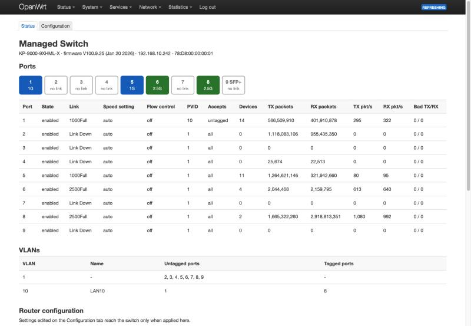
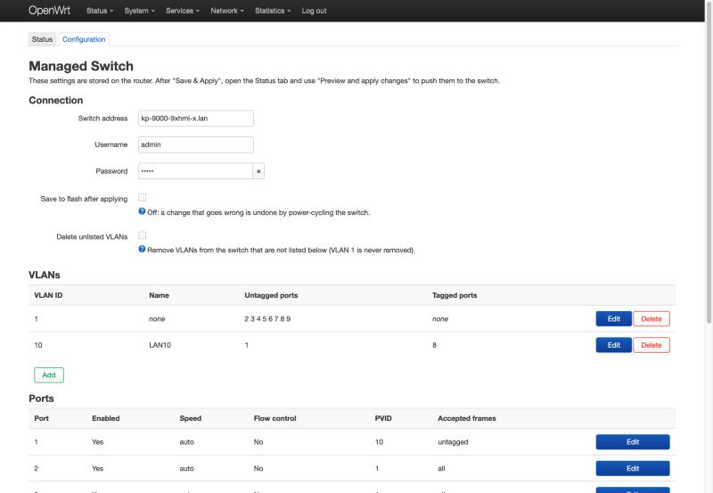
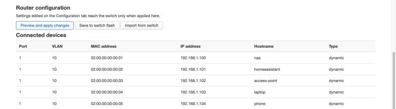
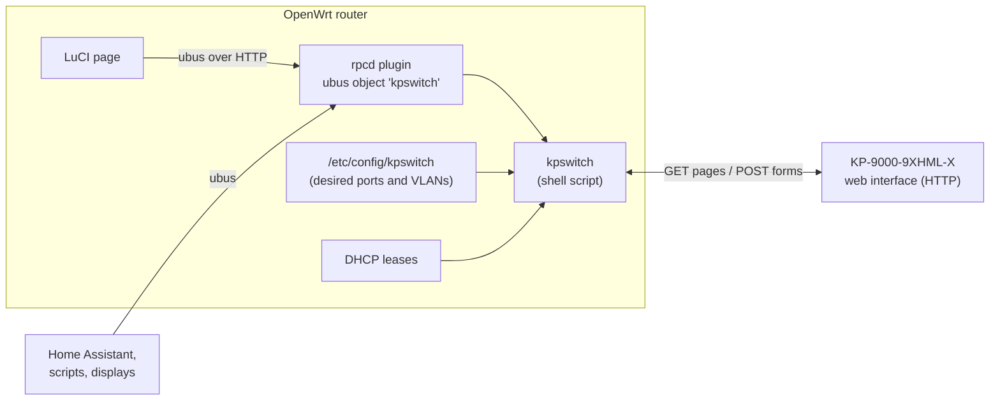

# kpswitch-openwrt

Manage a **KeepLiNK KP-9000-9XHML-X** web-managed switch (8 × 2.5G + 1 × 10G SFP+)
from an OpenWrt router: a command-line tool, a ubus object and a LuCI page.

The switch: [product page on AliExpress](https://www.aliexpress.com/item/1005012046821834.html).

The switch has no SNMP, SSH or API, only its own web interface. `kpswitch` drives
that web interface over HTTP, so the router can hold the switch's configuration
and push it, and so port status is available to LuCI, Home Assistant or anything
else that can talk to ubus.



## What it does

- **Status:** link speed, packet counters, PVID and VLAN membership per port, and
  the MAC table joined with the router's DHCP leases (which device is on which port).
- **Configuration in UCI:** ports and VLANs live in `/etc/config/kpswitch`.
  `kpswitch apply` sends only the differences to the switch and reads them back
  to confirm.
- **ubus:** `ubus call kpswitch ports` (also `info`, `vlans`, `mac`, `diff`,
  `apply`, `save`, `import`).
- **LuCI:** *Network → Managed Switch*, with a Status tab and a Configuration tab.

Covered settings: port enable, speed/duplex, flow control, 802.1Q VLANs, PVID and
accepted frame type. Not covered: QoS, trunking, mirroring, STP, IGMP, storm
control and the other menus of the switch.

## Tested with

| | |
|---|---|
| Switch | KeepLiNK KP-9000-9XHML-X, hardware V3.2, firmware V100.9.25 (Jan 20 2026) |
| Bought from | [AliExpress listing](https://www.aliexpress.com/item/1005012046821834.html) (the listing also covers the PoE variant, KP-9000-9XHPML-X-AC, which is untested) |
| Router | OpenWrt 25.12 (FriendlyWrt on a NanoPi R5S) |

Many unbranded 2.5G switches share this firmware family (pages named `port.cgi`,
`vlan.cgi?page=static`, a `login.cgi` that sets an `admin=` cookie). They may work
unchanged or with small tweaks, but only the model above has been tested.

## Requirements

On the router: `curl` and LuCI (for the web page). Everything else (`md5sum`,
`awk`, `jshn`) is in a stock OpenWrt image.

```sh
apk add curl      # OpenWrt 25.12 and later
opkg install curl # OpenWrt 24.10 and earlier
```

## Install

From a computer with SSH access to the router:

```sh
git clone https://github.com/shubhobrataroy/kpswitch-openwrt.git
cd kpswitch-openwrt
./install.sh root@192.168.1.1
```

Then, on the router:

```sh
uci set kpswitch.main.host='192.168.1.50'        # your switch's address
uci set kpswitch.main.password='YOUR_SWITCH_PASSWORD'
uci commit kpswitch

kpswitch info        # should print the model and firmware
kpswitch import -w   # copy the switch's current ports and VLANs into UCI
```

Log out of LuCI and back in once; the page appears under *Network → Managed Switch*.

`install.sh` never overwrites an existing `/etc/config/kpswitch`, and adds the
installed files to `/etc/sysupgrade.conf` so they survive a firmware upgrade.

## Command line

```
kpswitch info            device model, firmware, IP
kpswitch ports           link, speed, PVID and packet counters per port
kpswitch vlans           802.1Q VLAN table
kpswitch mac             MAC table (with DHCP hostnames where known)
kpswitch json <info|ports|vlans|mac>
kpswitch import [-w]     turn the switch's current state into UCI
kpswitch diff            show what "apply" would change
kpswitch apply           push UCI config to the switch
kpswitch save            store the switch's running config to its flash
kpswitch raw <page>      dump a raw page, e.g. "port.cgi?page=stats"
```

```
# kpswitch ports
PORT  STATE    LINK       CONFIG  FLOW  PVID  ACCEPT           TX_PKTS        RX_PKTS  TX_BAD  RX_BAD
1     enabled  1000Full   auto    off   10    untagged       566212566      401781753       0       0
2     enabled  Link Down  auto    off   1     all           1118083106      955435350       0       0
6     enabled  2500Full   auto    off   1     all              1856957        1962678       0       0
8     enabled  2500Full   auto    off   1     all           1664964239     2918152290       0       0

# kpswitch apply
applying:
  port 7: enable|speed|flow 1|auto|0 -> 1|auto|1
verifying:
  ok, 1 change(s) live
not saved to flash: a switch power-cycle undoes this. Run 'kpswitch save' to keep it.
```

## Configuration

`/etc/config/kpswitch` (see [kpswitch.config](kpswitch.config) for the template):

```
config switch 'main'
	option host '192.168.1.50'
	option username 'admin'
	option password '...'
	option autosave '0'   # 1 = save to the switch's flash after a successful apply
	option prune '0'      # 1 = delete switch VLANs that are not listed here

config vlan 'vlan10'
	option vid '10'
	option name 'LAN10'
	list untagged '1'
	list tagged '8'

config port 'port1'
	option port '1'
	option enable '1'
	option speed 'auto'      # auto 10h 10f 100h 100f 1000f 2500f (port 9: auto 100f 1000f 2500f 10gf)
	option flow '0'
	option pvid '10'
	option accept 'untagged' # all | tagged | untagged
```

Options left out of a `port` section are not touched on the switch.

## LuCI

The Configuration tab edits the same UCI file. LuCI's *Save & Apply* only stores
the settings on the router; press **Preview and apply changes** on the Status tab
to see the differences and push them to the switch.





## Safety

- **Changes are not saved to flash by default.** If a VLAN change cuts the router
  off from the switch, power-cycle the switch and it returns to its last saved
  state. Run `kpswitch save` (or set `autosave '1'`) once you are happy.
- **Run `kpswitch diff` first.** Be careful with the uplink port and with the VLAN
  the switch's own management address lives in.
- **VLANs are never deleted** unless `prune '1'` is set, and VLAN 1 never is.

## Security notes

- The switch only speaks plain HTTP. Its session cookie is the MD5 of
  username + password, and the login form sends the password in clear text, so
  keep the switch's management address on a network you trust.
- The switch password is stored in `/etc/config/kpswitch` on the router
  (mode 600) and is readable by LuCI administrators.
- Change the switch's default password.

## How does it work?

The switch cannot be managed by OpenWrt natively: it is a separate box with its
own firmware, and the only way in is the web page you would normally click
through in a browser. `kpswitch` is a shell script on the router that does the
same clicking for you, by sending the same HTTP requests the browser would.



**1. Logging in.** The switch's login page does not create a real session. It
sets a cookie, `admin=`, to the MD5 of the username and password joined
together, and every later request is accepted if it carries that cookie. The
script computes the same value from the credentials in UCI and sends it with
every request. If the switch answers with its "go to the login page" redirect,
the script posts the login form once and retries.

**2. Reading.** Status pages are plain HTML tables. The script downloads a
page, splits it into table rows, strips the tags and keeps the rows that look
like data (for example rows starting with `Port 3`). That turns `port.cgi`,
`port.cgi?page=stats`, the two VLAN pages and the MAC table into simple
internal tables, which are then printed as text or as JSON. Packet counters
arrive as two 32-bit halves and are joined into one number. MAC addresses are
matched against the router's DHCP leases to add an IP address and hostname.

**3. Holding the configuration.** The ports and VLANs you want are stored in
UCI on the router, like any other OpenWrt setting. `kpswitch import -w` fills
that file from the switch's current state, so you start from what is already
running.

**4. Applying.** `kpswitch apply` reads the switch, compares it with UCI and
builds a list of differences. For each difference it submits the same form the
web page would: VLANs first, then PVIDs, then port settings, then (only if
`prune` is on) VLAN deletions. Settings that already match are not sent.
`kpswitch diff` prints the same list without sending anything.

**5. Verifying.** After applying, the script reads the switch again, retrying
for a few seconds because the switch is slow to report a new setting. If
anything still differs it stops with an error and does not save. Only when
everything matches, and `autosave` is on, does it ask the switch to store the
running settings in its flash.

**6. ubus and LuCI.** A small rpcd plugin wraps the script as the ubus object
`kpswitch`. The LuCI page is client-side JavaScript that calls those ubus
methods: the Status tab polls `ports` every 5 seconds, and its buttons call
`diff`, `apply`, `save` and `import`. The Configuration tab is a normal LuCI
form over the UCI file.

### Requests sent to the switch

| Action | Request to the switch |
|---|---|
| Log in | `POST login.cgi` with `username`, `password`, `Response=md5(user+pass)`; cookie `admin=<same md5>` |
| Port status | `GET port.cgi`, `GET port.cgi?page=stats` |
| Port settings | `POST port.cgi` with `portid`, `state`, `speed_duplex`, `flow`, `cmd=port` |
| VLAN table | `GET vlan.cgi?page=static` |
| Add/modify VLAN | `POST vlan.cgi?page=static` with `vid`, `name`, `vlanPort_0..8` (0 untagged, 1 tagged, 2 not member) |
| Delete VLAN | `POST vlan.cgi?page=getRmvVlanEntry` with `remove_<vid>=on` |
| PVID / frame type | `POST vlan.cgi?page=port_based` with `ports`, `pvid`, `vlan_accept_frame_type` |
| MAC table | `GET mac.cgi?page=fwd_tbl` (`POST cmd=nextpage` for more pages) |
| Save to flash | `POST save.cgi` with `cmd=save` |

Ports are numbered from 0 in the requests and from 1 everywhere else.

## Files

| File | Installed as |
|---|---|
| `kpswitch` | `/usr/sbin/kpswitch` |
| `kpswitch.config` | `/etc/config/kpswitch` (only if missing) |
| `rpcd-kpswitch` | `/usr/libexec/rpcd/kpswitch` |
| `rpcd-acl.json` | `/usr/share/rpcd/acl.d/luci-app-kpswitch.json` |
| `luci/menu.json` | `/usr/share/luci/menu.d/luci-app-kpswitch.json` |
| `luci/status.js`, `luci/config.js` | `/www/luci-static/resources/view/kpswitch/` |

## Known gaps

- Multi-page MAC tables, VLAN deletion (`prune`) and `kpswitch save` are
  implemented but have not been exercised on real hardware.
- Only port settings have been pushed to a real switch so far; VLAN and PVID
  changes use the forms listed above but are untested live.

## Licence

[MIT](LICENSE)
